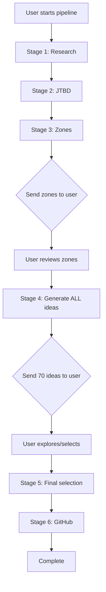

# Pipeline V2 Technical Architecture Plan
## Lambda + SQS + WebSocket Deep Dive Analysis

### **Executive Summary**

After comprehensive research into AWS Lambda + SQS + WebSocket architecture patterns, current pipeline analysis, and 2025 AWS service limitations, here is the detailed technical plan for implementing Pipeline V2 with interactive user control points.

**Key Finding**: This architecture is **feasible and well-supported** by AWS as of 2025, with established patterns, solution constructs, and cost-effective pricing models.

---

## **Current Pipeline Analysis**

### **Execution Profile (From Code Analysis)**
- **Total Runtime**: 15-20 minutes average (20 minutes per infrastructure/lambda_pipeline_status.py:L434)
- **API Cost Breakdown**: ~$2-5 per run in LLM API fees
  - Stage 2 (JTBD): ~50 API calls, ~$0.50 (jobs_to_reddit.py:L32-34)  
  - Stage 4 (Ideas): 40% of execution time, 60% of API costs (product_idea_generator.py:L13)
  - Stage 6 (GitHub): 11 GPT-5 API calls (github_integration.py:L18)

### **Stage-by-Stage Breakdown**
```
Stage 1: Research Analysis     - 3 minutes  - 4 parallel Claude calls
Stage 2: JTBD + Reddit        - 5 minutes  - ~50 sequential API calls  
Stage 3: Opportunity Zones    - 4 minutes  - Light computation, clustering
Stage 4: Product Ideas        - 6 minutes  - Heavy LLM calls (o1, Opus, GPT-5)
Stage 5: Consolidation        - 2 minutes  - Light LLM enhancement
Stage 6: GitHub Creation      - 2 minutes  - 11 GPT-5 API calls
```

### **Critical Insight: Stage 4 Complexity**
Stage 4 (product_idea_generator.py) is the most complex:
- **Generates 10 ideas per zone** (typically 7 zones = 70 total ideas)
- **Uses 5 different AI models**: o1, Opus, GPT-4o, GPT-5, sophisticated scoring
- **Current filtering**: Shows only 10 final ideas, discards 60+ alternatives
- **This is exactly the user control point we need to expose**

---

## **AWS Lambda + SQS + WebSocket Architecture (2025)**

### **Service Capabilities & Limitations**

#### **AWS Lambda (2025)**
- **Maximum timeout**: 15 minutes (900 seconds) - **unchanged in 2025**
- **Memory limit**: 10,240 MB
- **Concurrent executions**: 1,000 default (can be increased)
- **Cold start**: ~30 seconds worst case for large functions
- **Pricing**: $0.0000166667 per GB-second

#### **API Gateway WebSocket (2025)**
- **Message pricing**: $1.00 per million messages (first 1B), $0.80 per million after
- **Connection minutes**: $0.25 per million connection minutes
- **Message size**: Metered in 32KB increments
- **2025 Free tier**: Up to $200 in credits for new customers (starting July 15, 2025)
- **Connection management**: Built-in $connect/$disconnect routes

#### **SQS Integration**
- **Standard queues**: $0.40 per million requests
- **FIFO queues**: $0.50 per million requests  
- **Message retention**: 14 days maximum
- **Visibility timeout**: 12 hours maximum

### **Proven Architecture Patterns**
Based on AWS documentation and solution constructs:

```
Frontend WebSocket ←→ API Gateway WebSocket API ←→ Lambda Orchestrator
                                                         ↓
                                                    SQS FIFO Queue
                                                         ↓
                                              Pipeline Stage Lambdas
                                                         ↓
                                                   DynamoDB (State)
                                                         ↓
                                                    S3 (Results)
```

---

## **Detailed Technical Design**

### **Component Architecture**

#### **1. WebSocket API Gateway**
```yaml
Routes:
  $connect: Connection establishment + DynamoDB session storage
  $disconnect: Cleanup session state
  user-input: Handle user decisions during pipeline pauses
  ping: Keep-alive heartbeat
Integration:
  - Direct SQS FIFO integration (no intermediate Lambda)
  - Connection state in DynamoDB
  - Message size limit: 128KB per WebSocket message
```

#### **2. Connection Management (DynamoDB Table)**
```json
PipelineSessionsTable:
{
  "connectionId": "abc123",           // WebSocket connection ID
  "userId": "user456",               // User identifier
  "pipelineRunId": "run789",         // Pipeline execution ID
  "currentStage": "awaiting_zones",   // Current decision point
  "stageData": {...},                // Stage-specific data
  "timestamp": "2025-01-01T12:00:00Z",
  "ttl": 1704110400                  // Auto-cleanup after 24 hours
}
```

#### **3. Pipeline Stage Functions**

**Stage 1: Research Analysis Lambda**
- **Timeout**: 5 minutes (well under 15min limit)
- **Memory**: 1024 MB  
- **Triggers**: SQS message from orchestrator
- **Dependencies**: Anthropic SDK (Claude)
- **Output**: Analysis results to S3, completion message to SQS

**Stage 2: JTBD + Reddit Lambda**
- **Timeout**: 8 minutes (50 API calls at 10s average = ~500s)
- **Memory**: 1024 MB
- **Dependencies**: Anthropic SDK, PRAW (Reddit API)
- **Critical**: Sequential API calls, longest-running "simple" stage

**Stage 3: Opportunity Zones Lambda** 
- **Timeout**: 5 minutes (light computation)
- **Memory**: 2048 MB (for clustering algorithms)
- **Dependencies**: scikit-learn, pandas, anthropic
- **Output**: Zones with market scores

**Stage 4: Product Ideas Lambda** ⭐ **CRITICAL STAGE**
- **Timeout**: 14 minutes (maximum safe timeout)
- **Memory**: 3008 MB (multiple model instantiation)
- **Dependencies**: OpenAI SDK, Anthropic SDK, scoring modules
- **Key Change**: Store ALL 70 generated ideas, not just final 10
- **Decision Point**: Send all ideas to user via WebSocket

**Stages 5 & 6**: Quick execution (< 5 minutes each)

#### **4. Orchestrator Lambda**
```python
# Pseudo-code for orchestrator logic
def lambda_handler(event, context):
    session_id = event['session_id']
    current_stage = get_current_stage(session_id)
    
    if current_stage == "stage_4_complete":
        # Send all 70 ideas to user via WebSocket
        all_ideas = load_from_s3(f"ideas_all_{session_id}.json")
        send_websocket_message(session_id, {
            "type": "ideas_review",
            "data": all_ideas,
            "zones": 7,
            "total_generated": 70
        })
        # Wait for user input (function ends, user decides)
        
    elif event.get('user_decision'):
        # Process user selection and continue
        selected_criteria = event['user_decision']
        trigger_final_selection(session_id, selected_criteria)
```

#### **5. SQS Queue Structure**
```yaml
PipelineStageQueue (FIFO):
  - MessageGroupId: session_id (ensures ordering per session)  
  - MessageDeduplicationId: stage_timestamp
  - Message body: {"stage": "stage_2", "session_id": "...", "data": {...}}

PipelineResultsQueue:
  - Completion notifications
  - User decision triggers
```

### **Data Flow & State Management**

#### **Session State Transitions**


#### **User Decision Points**
1. **After Stage 3**: "Here are 7 opportunity zones - do they align with your understanding?"
2. **After Stage 4**: "Here are ALL 70 generated ideas across zones - which direction interests you?"
3. **Before Final Selection**: "Based on your interests, here's our recommended final 10 - adjust selection criteria?"

#### **Data Storage Pattern**
```
S3 Bucket Structure:
/sessions/
  /{session_id}/
    /stage_1_analysis.md
    /stage_2_jtbds.txt
    /stage_2_reddit.csv  
    /stage_3_zones.json
    /stage_4_ideas_all.json      ← NEW: All 70 ideas
    /stage_4_ideas_final.json    ← Existing: Final 10
    /stage_5_portfolio.json
    /user_decisions.json         ← NEW: User choices
```

---

## **Cost Analysis**

### **Per-Pipeline Execution Costs**

#### **WebSocket API Gateway**
- **Connection time**: 20 minutes average = 0.33 hours
- **Messages**: ~20 messages (status updates + user decisions)  
- **Cost**: $0.25 * 0.33/1M + $1.00 * 20/1M = **~$0.00001**

#### **Lambda Execution**
```
Stage 1: 1024MB × 300s = 307,200 GB-seconds × $0.0000166667 = $0.0051
Stage 2: 1024MB × 480s = 491,520 GB-seconds × $0.0000166667 = $0.0082  
Stage 3: 2048MB × 240s = 491,520 GB-seconds × $0.0000166667 = $0.0082
Stage 4: 3008MB × 840s = 2,526,720 GB-seconds × $0.0000166667 = $0.0421
Stage 5: 1024MB × 120s = 122,880 GB-seconds × $0.0000166667 = $0.0020
Stage 6: 1024MB × 120s = 122,880 GB-seconds × $0.0000166667 = $0.0020
Orchestrator: 512MB × 60s = 30,720 GB-seconds × $0.0000166667 = $0.0005

Total Lambda: ~$0.07 per execution
```

#### **SQS**  
- **Messages**: ~20 messages per pipeline
- **Cost**: $0.50 * 20/1M = **$0.00001**

#### **DynamoDB**
- **Session storage**: 1 item write + reads
- **Cost**: **~$0.0001**

#### **S3 Storage**
- **Per session**: ~10MB of results
- **Cost**: $0.023 * 0.01 = **$0.00023/month**

**Total Infrastructure Cost per Execution: ~$0.07**
**Total Cost (Infrastructure + LLM APIs): $2.07-5.07** (vs current $2-5)

### **Monthly Cost Estimates**
- **100 pipeline runs/month**: $7 infrastructure + $300 LLM = **$307/month**
- **1,000 pipeline runs/month**: $70 infrastructure + $3,000 LLM = **$3,070/month**

*Infrastructure costs scale nearly linearly due to serverless pricing*

---

## **Implementation Complexity Assessment**

### **Low Complexity Components** ✅
- **WebSocket API Gateway**: AWS Solutions Construct available
- **SQS Integration**: Well-documented patterns
- **DynamoDB session management**: Standard pattern
- **Basic Lambda functions**: Straightforward conversion

### **Medium Complexity Components** ⚠️  
- **Stage 4 Lambda conversion**: Must preserve all generated ideas
- **User decision processing**: JSON schema validation, state transitions
- **Error handling**: Distributed system failure modes
- **Connection state management**: Handle dropped WebSocket connections

### **High Complexity Components** 🔴
- **Pipeline orchestration logic**: Complex state machine in code
- **Result data transformation**: Converting file-based I/O to S3/JSON
- **Frontend integration**: Real-time UI updates, decision interfaces

### **Migration Strategy**

#### **Phase 1: Foundation (Week 1-2)**
- Deploy WebSocket API Gateway + basic connection management
- Create DynamoDB session table
- Build orchestrator Lambda skeleton
- Test WebSocket connection establishment/teardown

#### **Phase 2: Stage Conversion (Week 3-4)**
- Convert Stages 1,2,3,5,6 to Lambda functions
- Test each stage independently with mocked data
- Implement SQS messaging between stages

#### **Phase 3: Critical Stage 4 (Week 5)**
- Convert Stage 4 with expanded result storage
- Test idea generation and storage of ALL ideas
- Implement user decision collection via WebSocket

#### **Phase 4: Integration & Testing (Week 6-7)**
- End-to-end pipeline testing
- Frontend integration
- Load testing and performance optimization
- Error handling and recovery

#### **Phase 5: Production Deployment (Week 8)**
- Blue-green deployment strategy
- Monitoring and alerting setup
- Documentation and runbooks

---

## **Risk Assessment & Mitigation**

### **Technical Risks**

#### **🔴 HIGH RISK: Stage 4 Lambda Timeout**
- **Risk**: Complex AI processing might exceed 15 minutes
- **Likelihood**: Medium (currently 6 minutes, but variable)
- **Mitigation**: 
  - Split into smaller sub-functions if needed
  - Implement progress checkpointing
  - Use ECS Fargate as fallback for this stage only

#### **🟡 MEDIUM RISK: WebSocket Connection Drops**
- **Risk**: User loses connection during decision point
- **Mitigation**: 
  - Session persistence in DynamoDB
  - Reconnection logic with session restore
  - Email/SMS fallback for critical decisions

#### **🟡 MEDIUM RISK: Lambda Cold Starts**
- **Risk**: 30+ second delays during pipeline execution
- **Mitigation**:
  - Provisioned concurrency for critical functions
  - Pre-warming via scheduled CloudWatch Events
  - Keep functions "warm" during active sessions

#### **🟢 LOW RISK: Cost Overruns**
- **Risk**: Unexpected AWS service costs
- **Mitigation**: 
  - CloudWatch cost alerts
  - Per-session cost tracking
  - Usage quotas and circuit breakers

### **Business Risks**

#### **🟡 MEDIUM RISK: User Experience Degradation**  
- **Risk**: Interactive flow is slower than current batch processing
- **Mitigation**:
  - Clear progress indicators
  - Ability to save/resume sessions
  - Option to run in "auto-pilot" mode (current behavior)

#### **🟢 LOW RISK: Development Timeline**
- **Risk**: 8-week timeline may be optimistic
- **Mitigation**:
  - MVP with fewer decision points first
  - Parallel development tracks
  - Fallback to enhanced batch mode

---

## **Operational Considerations**

### **Monitoring & Alerting**
- **CloudWatch Dashboards**: Pipeline execution metrics, WebSocket connections
- **X-Ray Tracing**: End-to-end request tracing across Lambda functions
- **Custom Metrics**: User decision response times, abandonment rates
- **Cost Monitoring**: Per-session cost tracking and alerting

### **Scaling Considerations**
- **Concurrent pipelines**: Architecture supports 100+ concurrent sessions
- **WebSocket connections**: API Gateway supports thousands of concurrent connections
- **Lambda concurrency**: Monitor and adjust reserved capacity
- **Database scaling**: DynamoDB on-demand scaling enabled

### **Security**
- **Authentication**: JWT tokens for WebSocket connections
- **Authorization**: IAM roles with least privilege
- **Data encryption**: All S3 data encrypted at rest
- **API keys**: Secrets Manager integration maintained
- **Network security**: Private VPC for sensitive operations

### **Backup & Recovery**
- **Session data**: S3 versioning enabled
- **State recovery**: DynamoDB point-in-time recovery
- **Pipeline restart**: Ability to resume from any stage
- **Data retention**: 30-day retention policy for debugging

---

## **Success Metrics**

### **Technical Metrics**
- **Pipeline completion rate**: >95% (vs current 98%+)
- **Average execution time**: 20-25 minutes (vs current 20 minutes)
- **WebSocket connection stability**: >99.5% uptime
- **Lambda cold start rate**: <10% of executions

### **User Experience Metrics**
- **User engagement**: % of users who interact with decision points  
- **Session completion**: % of users who complete interactive pipeline
- **Idea exploration**: Average number of ideas reviewed per session
- **User satisfaction**: Survey scores on control vs automation

### **Business Metrics**
- **Cost per pipeline**: <$5.50 total (vs current $2-5)
- **Infrastructure utilization**: >80% of provisioned capacity
- **Feature adoption**: % of users choosing interactive mode
- **Pipeline throughput**: Concurrent executions handled

---

## **Conclusion & Recommendation**

### **Technical Feasibility: ✅ FEASIBLE**
The Lambda + SQS + WebSocket architecture is **well-established and fully supported** by AWS as of 2025. The 15-minute Lambda timeout provides sufficient headroom for all pipeline stages, and WebSocket pricing is cost-effective for our use case.

### **Business Value: ✅ HIGH**  
This architecture directly addresses the core user need: **visibility into the filtering process**. Users will see all 70 generated ideas instead of just the final 10, fundamentally changing the user experience from "black box" to "collaborative intelligence."

### **Implementation Risk: 🟡 MANAGEABLE**
While technically complex, the risk is manageable with proper phase planning and AWS's mature serverless ecosystem. The biggest risk is Stage 4 Lambda timeout, but multiple mitigation strategies exist.

### **Cost Impact: ✅ MINIMAL**
Infrastructure costs increase by only ~$0.07 per pipeline execution (~1-2% increase), while dramatically improving user experience and control.

### **Strategic Recommendation: PROCEED**

**Recommended approach**: Start with **Phase 1-2 implementation** to validate the architecture, then commit to full implementation based on early results. The WebSocket + Lambda pattern is proven, cost-effective, and aligns perfectly with the user control requirements.

The core insight remains: **Transform "Here are your 10 results" into "Here are ALL 70 generated ideas organized by opportunity zone - which ones align with your vision?"**

---

*This analysis was conducted based on current AWS service capabilities, 2025 pricing, established architecture patterns, and detailed examination of the existing pipeline codebase.*