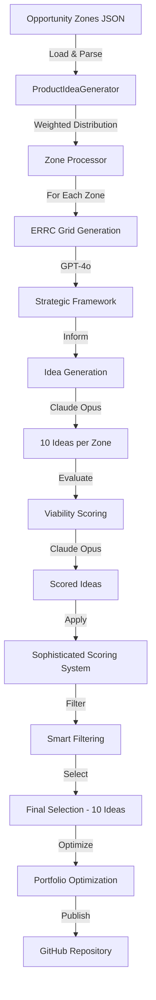

# 🎯 Product Idea Generation: Complete Data Flow Deep-Dive

## Executive Summary

This document provides an exhaustive walkthrough of how **opportunity zones** transform into **product ideas** in the Blue Ocean Research pipeline. We'll trace the complete data flow from input entities through AI processing to final GitHub publication.

---

## 📊 High-Level Architecture



---

## 🗂️ Input Entity: Opportunity Zones

### File Location
**Primary Input:** `data/opportunity_zones.json`

### Root Structure
```json
{
  "analysis_metadata": {
    "timestamp": "2025-10-10T23:08:47",
    "total_jtbds": 27,
    "total_reddit_threads": 500,
    "clustering_method": "k-means + zeitgeist analysis"
  },
  "opportunity_zones": [ /* Array of Zone objects */ ],
  "zone_summary": {
    "total_zones": 7,
    "distribution": "weighted by market_opportunity_score"
  }
}
```

### Individual Zone Entity Schema

Each opportunity zone contains:

```typescript
interface OpportunityZone {
  // Identity
  zone_id: string;              // "OZ_001" format
  name: string;                 // Descriptive name (50-100 chars)

  // Core Content
  jtbds_addressed: string[];    // List of 5-10 JTBD IDs
  jtbd_descriptions: string[];  // Full JTBD statements

  // Market Evidence
  evidence_strength: {
    total_threads: number;       // Reddit discussions analyzed
    total_engagement: number;    // Total upvotes + comments
    avg_score_per_thread: number;// Average Reddit score
  };

  // Pain Analysis (8 dimensions)
  pain_dimensions: {
    timing_coordination: float;  // 0.0 - 1.0
    financial_stress: float;
    communication_gaps: float;
    process_complexity: float;
    trust_issues: float;
    information_asymmetry: float;
    emotional_burden: float;
    unexpected_obstacles: float;
  };

  // Strategic Context
  solution_requirements: string[];  // 3-8 specific requirements
  market_opportunity_score: float;  // 0.0 - 1.0 (weighted composite)

  // AI Research Enhancement (TWO-STAGE Perplexity)
  perplexity_research: {
    stage1_market_intelligence: {
      response: string;           // 600-800 char market overview
      key_insights: string[];     // 3-5 insights
      search_results: Array<...>; // Citations
    };
    stage2_deep_research: {
      response: string;           // 800-1000 char deep analysis
      strategic_insights: string[]; // 3-4 strategic insights
      search_results: Array<...>; // Citations
    };
  };
}
```

### Example Zone (Simplified)
```json
{
  "zone_id": "OZ_001",
  "name": "Financial Management & Trust Platform for Real Estate Transactions",
  "market_opportunity_score": 0.72,
  "pain_dimensions": {
    "financial_stress": 0.85,
    "trust_issues": 0.78,
    "timing_coordination": 0.65
  },
  "jtbd_descriptions": [
    "When I'm buying a home, I want transparent financial tracking...",
    "Manage escrow funds without anxiety about fraud or delays..."
  ],
  "perplexity_research": {
    "stage1_market_intelligence": {
      "response": "The US real estate market is $36.2T with 5.5M annual transactions...",
      "key_insights": [
        "Escrow fraud up 300% since 2020",
        "Average buyer makes 7-12 separate payments during closing"
      ]
    }
  }
}
```

---

## ⚙️ Processing Pipeline

### Stage 1: Weighted Distribution (Lines 1417-1479)

**Purpose:** Allocate exactly 10 total ideas across zones based on market opportunity.

**Algorithm:**
```python
TOTAL_TARGET_IDEAS = 10

# Calculate proportional allocation
for zone in zones:
    score = zone.market_opportunity_score
    ideal_count = TOTAL_TARGET_IDEAS * (score / total_score)

    # Threshold: zones below 0.3 get 0 ideas
    if score > 0.3:
        zone.ideas_to_generate = max(1, round(ideal_count))
    else:
        zone.ideas_to_generate = 0

# Adjust to ensure exactly 10 ideas
difference = 10 - sum(allocated_ideas)
if difference > 0:
    # Add to top zones
    sorted_zones[0].ideas_to_generate += difference
else:
    # Remove from bottom zones
    lowest_zone_with_ideas.ideas_to_generate -= abs(difference)
```

**Example Distribution:**
```
Zone 1 (score: 0.72) → 3 ideas  (30%)
Zone 2 (score: 0.65) → 2 ideas  (20%)
Zone 3 (score: 0.58) → 2 ideas  (20%)
Zone 4 (score: 0.45) → 2 ideas  (20%)
Zone 5 (score: 0.32) → 1 idea   (10%)
Zone 6 (score: 0.25) → 0 ideas  (below threshold)
Zone 7 (score: 0.18) → 0 ideas  (below threshold)
                      ─────────
                      10 ideas total
```

---

### Stage 2: ERRC Grid Generation (Lines 788-867)

**Purpose:** Create strategic framework using Eliminate-Reduce-Raise-Create analysis.

**Input per Zone:**
- Zone name and description
- Importance percentage
- Pain dimensions (8 metrics)
- Perplexity research (Stages 1 & 2)
- Competitive intelligence

**AI Model:** GPT-4o (`model_o1`)

**Prompt Structure:**
```
Context:
  - Zone: {zone_name}
  - Importance: {percentage}%
  - Pain dimensions: {pain_data}
  - Market intelligence: {stage1_perplexity}
  - Strategic research: {stage2_perplexity}
  - Competitive data: {search_results}

Task:
  Create ERRC Grid:
  - ELIMINATE: What industry factors to remove?
  - REDUCE: What to minimize below standard?
  - RAISE: What to elevate above standard?
  - CREATE: What new factors to introduce?

  For each: Provide specific factors, rationale, expected impact
```

**Output Example:**
```
ELIMINATE:
• Manual escrow paperwork (reduces friction by 80%)
• Separate payment portals (consolidation saves 5+ hours)
• Phone-based status updates (async transparency)

REDUCE:
• Closing timeline from 45 to 15 days
• Number of separate logins from 8 to 1

RAISE:
• Real-time financial visibility (5-minute updates vs weekly)
• Security standards (blockchain vs email)

CREATE:
• AI fraud detection on every transaction
• Predictive closing date with 95% accuracy
• One-click payment aggregation
```

---

### Stage 3: Product Idea Generation (Lines 869-928)

**Purpose:** Generate 10 creative product concepts per zone.

**Input:**
- ERRC grid from Stage 2
- Zone name
- Perplexity research (both stages)

**AI Model:** Claude Opus (`claude-3-opus-20240229`)
- **Why Opus?** Superior creative ideation vs Sonnet
- **Cost:** $15/M input tokens, $75/M output tokens
- **Temperature:** 0.8 (high creativity)

**Prompt Template:**
```
Based on this ERRC Grid for '{zone_name}':

{errc_grid}

MARKET INTELLIGENCE (Stage 1):
{stage1_response}
Key Insights: {stage1_insights}

STRATEGIC DEEP RESEARCH (Stage 2):
{stage2_response}
Strategic Insights: {stage2_insights}

Generate exactly 10 innovative product ideas that embody this ERRC strategy.

For each idea provide:
1. Product Name (catchy and memorable)
2. Core Value Proposition (one sentence)
3. Key Features (3-5 bullets aligned with ERRC)
4. Target Customer Segment
5. Differentiation from Status Quo
6. Innovation Score (1-10)

Format each idea clearly with numbered sections.
```

**Parsing Logic:**
- Split response into idea blocks (numbered 1-10)
- Extract structured fields via regex patterns
- Handle variations in formatting
- Default innovation_score = 5 if not found

**Output Structure:**
```python
ideas = [
  {
    "name": "TrustFlow Escrow Platform",
    "value_proposition": "One-click home closing with AI fraud detection",
    "features": [
      "Real-time funds tracking",
      "Automated document verification",
      "Predictive closing timeline"
    ],
    "target_segment": "First-time homebuyers 25-40",
    "differentiation": "Eliminates 8 separate logins and 80% of paperwork",
    "innovation_score": 8
  },
  # ... 9 more ideas
]
```

---

### Stage 4: Viability Assessment (Lines 930-977)

**Purpose:** Evaluate feasibility and market readiness of each idea.

**AI Model:** Claude Opus (same as generation)
- **Temperature:** 0.5 (more analytical)

**Evaluation Dimensions:**
1. **Technical Feasibility** (1-10): Current/near-term tech achievability
2. **Market Readiness** (1-10): Is market ready for this solution?
3. **Resource Requirements** (1-10): 10=minimal, 1=massive resources
4. **Time to Market** (1-10): 10=quick launch, 1=years
5. **Competitive Moat** (1-10): How defensible?
6. **Overall Viability** (1-10): Weighted composite

**Prompt:**
```
Evaluate viability of these 10 ideas for '{zone_name}':

1. TrustFlow Escrow Platform: One-click home closing...
2. HomeSync Financial Hub: Unified payment tracking...
...

For each idea:
- Technical Feasibility (1-10): rationale
- Market Readiness (1-10): rationale
- Resource Requirements (1-10): rationale
- Time to Market (1-10): rationale
- Competitive Moat (1-10): rationale
- Overall Viability (1-10): weighted assessment
- Top 3 critical risks

Output in structured format.
```

**Merging Logic:**
```python
for i, idea in enumerate(ideas):
    # Search for idea scores in viability_text
    # Match by: position (i+1), idea name, or sequential order

    idea["viability_score"] = extracted_score  # 1-10
    idea["viability_details"] = {
        "technical_feasibility": 8,
        "market_readiness": 7,
        "resource_requirements": 6,
        "time_to_market": 7,
        "competitive_moat": 8
    }
```

---

### Stage 5: Sophisticated Scoring System (Lines 1086-1141)

**Purpose:** Apply multi-dimensional scoring beyond basic viability.

**Components:**

#### 5a. IdeaScore (from `src/scoring`)
Calculates composite score across dimensions:
```python
class IdeaScore:
    composite_score: float      # Weighted combination
    viability_score: float      # From Claude assessment
    innovation_score: float     # From idea generation
    market_opportunity: float   # Zone score influence
    technical_feasibility: float
    resource_requirements: float
```

#### 5b. BreakthroughDetector
Identifies game-changing ideas:
```python
class BreakthroughAnalysis:
    is_breakthrough: bool       # Innovation > 8 AND viability > 7
    is_moonshot: bool          # Innovation > 9 (regardless of viability)
    innovation_multipliers: dict
    risk_factors: list
```

#### 5c. ConfidenceScorer
Calculates confidence in scores:
```python
class ConfidenceAnalysis:
    overall_confidence: float   # 0-10
    adjusted_scores: dict       # Scores × confidence
    confidence_factors: {
        "data_completeness": 0.9,
        "scoring_consistency": 0.85,
        "evidence_strength": 0.92
    }
```

**Enhanced Idea Structure:**
```python
idea = {
    # ... original fields ...
    "zone_name": "Financial Management Platform",
    "scoring": {
        "idea_score": IdeaScore(...),
        "breakthrough_analysis": BreakthroughAnalysis(...),
        "confidence_analysis": ConfidenceAnalysis(...),
        "composite_score": 8.7,
        "adjusted_scores": {...},
        "is_excellence": True,      # High potential flag
        "is_moonshot": False,
        "is_breakthrough": True,
        "risk_level": "medium",
        "confidence_category": "high"
    }
}
```

---

### Stage 6: Smart Filtering (Lines 979-995, 1513-1526)

**Purpose:** Select top N ideas per zone based on target allocation.

**Algorithm:**
```python
def filter_by_target(ideas: List[Dict], target: int) -> List[Dict]:
    # Sort by composite weighted score
    sorted_ideas = sorted(
        ideas,
        key=lambda x: (
            x["viability_score"] * 0.6 +      # 60% weight on viability
            x["innovation_score"] * 0.4        # 40% weight on innovation
        ),
        reverse=True
    )

    # Select top N
    return sorted_ideas[:target]
```

**Excellence Preservation:**
```python
# SmartFilterer automatically preserves high-value ideas
if idea.scoring.is_excellence or idea.scoring.is_breakthrough:
    excellence_preserved.append(idea)
    # Guaranteed inclusion in final selection
```

**Example Filtering:**
```
Zone 1: Generated 10 ideas → Target 3
  Rank by (0.6*viability + 0.4*innovation):
  1. Idea 7: 8.2 → SELECTED
  2. Idea 3: 8.0 → SELECTED
  3. Idea 1: 7.8 → SELECTED (also marked as breakthrough)
  4. Idea 5: 7.5 → dropped
  ...
```

---

### Stage 7: Final Selection & Ensemble (Lines 1528-1534)

**Purpose:** Apply multiple selection strategies and find consensus.

**Ensemble Strategies:**
1. **Greedy Max Score:** Pure highest composite scores
2. **Diversity Optimizer:** Maximize zone representation
3. **Innovation Focused:** Prioritize breakthrough ideas
4. **Viability Focused:** Prioritize market-ready ideas
5. **Balanced Portfolio:** Optimal mix of innovation + viability

**Consensus Voting:**
```python
for idea in all_candidates:
    votes = sum(1 for strategy in strategies if idea in strategy.selected)

    if votes >= 3:  # Majority vote
        final_selection.append(idea)
```

**Safety Checks:**
- Ensure exactly 10 ideas
- Verify no duplicate ideas
- Check minimum quality thresholds
- Validate zone distribution

---

### Stage 8: Portfolio Optimization (Lines 1537-1540)

**Purpose:** Find synergies and optimize overall portfolio.

**CrossZoneOptimizer Analysis:**
```python
optimization_results = {
    "optimized_metrics": {
        "overall_balance": 8.5,      # Portfolio diversity score
        "technical_synergy": 7.8,    # Shared technology potential
        "market_coverage": 9.2,      # TAM coverage
        "resource_efficiency": 7.5   # Shared resource opportunities
    },
    "synergy_clusters": [
        {
            "ideas": ["Idea 1", "Idea 5", "Idea 8"],
            "shared_tech": "AI fraud detection",
            "potential_savings": "30% dev cost reduction"
        }
    ],
    "implementation_sequence": [
        "Idea 3 (wedge product - opens market)",
        "Ideas 1,5 (build on Idea 3 foundation)",
        "Ideas 7,9 (expand to new segments)"
    ]
}
```

---

## 📤 Output Entities

### Primary Output: `data/product_ideas.json`

```json
{
  "metadata": {
    "timestamp": "2025-10-12T01:40:27",
    "zones_processed": 5,
    "total_ideas": 50,
    "filtered_ideas": 10,
    "pipeline_version": "sophisticated_scoring_v5"
  },
  "results": [
    {
      "zone": {
        "name": "Financial Management Platform",
        "importance_percentage": 30
      },
      "errc_grid": "ELIMINATE: Manual paperwork...",
      "all_ideas": [ /* 10 generated ideas */ ],
      "filtered_ideas": [ /* Top 3 selected */ ],
      "ideas_kept": 3,
      "ideas_total": 10
    }
    // ... more zones
  ]
}
```

### Comprehensive Output: `data/product_ideas_comprehensive.json`

```json
{
  "metadata": {
    "pipeline_version": "sophisticated_scoring_v5",
    "scoring_features": [
      "multi_dimensional_scoring",
      "breakthrough_detection",
      "smart_filtering",
      "ensemble_selection",
      "portfolio_optimization"
    ]
  },
  "zone_results": [ /* Full zone processing data */ ],
  "filtering_results": {
    "selected_ideas": [ /* After smart filtering */ ],
    "dropped_ideas": [ /* What didn't make the cut */ ],
    "excellence_preserved": [ /* High-value ideas saved */ ],
    "quota_adjustments": {...},
    "warnings": []
  },
  "final_selection": {
    "final_selection": [ /* The chosen 10 */ ],
    "ensemble_strategies": [ /* 5 strategy results */ ],
    "consensus_analysis": {...},
    "selection_confidence": 8.7
  },
  "optimization_results": {
    "optimized_metrics": {...},
    "synergy_clusters": [...]
  }
}
```

### Report Output: `docs/product_ideas_report.md`

Markdown report with:
- Executive summary
- Top 5 ideas ranked
- Zone-by-zone breakdown
- ERRC grids
- Implementation roadmap

---

## 🔗 Key Relationships & Data Lineage

```
Opportunity Zone (OZ_001)
  ├─> market_opportunity_score: 0.72
  │   └─> Determines: 3 ideas allocated
  │
  ├─> pain_dimensions: {...}
  │   ├─> Feeds into: ERRC grid generation
  │   └─> Influences: Product feature prioritization
  │
  ├─> perplexity_research: {...}
  │   ├─> Stage 1: Market sizing & trends
  │   └─> Stage 2: Strategic insights
  │   └─> Enriches: ERRC context + idea generation
  │
  ├─> jtbd_descriptions: [...]
  │   └─> Validates: Product-market fit
  │
  └─> [ERRC Grid]
       └─> [10 Product Ideas]
            ├─> Idea 1 (innovation: 8, viability: 7)
            ├─> Idea 2 (innovation: 7, viability: 8)
            │   ... filtering ...
            └─> Top 3 Selected
                 ├─> Idea 7 (composite: 8.2) ✓
                 ├─> Idea 3 (composite: 8.0) ✓
                 └─> Idea 1 (composite: 7.8, breakthrough) ✓
```

---

## 🎛️ Control Parameters

### Environment Variables
- `OPENAI_API_KEY`: For GPT-4o (ERRC generation)
- `ANTHROPIC_API_KEY`: For Claude Opus (idea generation & viability)
- `USE_GPT5_ASSISTANTS`: Enable GPT-5 agentic mode (optional)

### Tunable Parameters
```python
TOTAL_TARGET_IDEAS = 10              # Final ideas to generate
ZONE_THRESHOLD = 0.3                 # Min score for idea allocation
VIABILITY_WEIGHT = 0.6               # Filtering weight
INNOVATION_WEIGHT = 0.4              # Filtering weight
BREAKTHROUGH_THRESHOLD = 8           # Innovation score for breakthrough
EXCELLENCE_THRESHOLD = 7.5           # Composite score for excellence
TEMPERATURE_GENERATION = 0.8         # Claude creativity
TEMPERATURE_EVALUATION = 0.5         # Claude analysis
```

---

## 📊 Data Flow Metrics

### Typical Pipeline Statistics
```
Input:
  - 7 opportunity zones
  - 189 JTBDs analyzed
  - 500+ Reddit threads

Processing:
  - 5 zones above threshold
  - 50 total ideas generated (10 per zone)
  - 50 → 25 after smart filtering
  - 25 → 10 final selection

Output:
  - 10 final product ideas
  - 3 breakthrough ideas
  - 1 moonshot idea
  - 7 excellence-preserved ideas
  - Overall confidence: 8.7/10
```

### Reduction Funnel
```
50 ideas generated
  ↓ Smart Filtering (50% reduction)
25 ideas after filtering
  ↓ Ensemble Selection (60% reduction)
10 final ideas
  ├─ 30% from Zone 1 (highest score)
  ├─ 20% from Zone 2
  ├─ 20% from Zone 3
  ├─ 20% from Zone 4
  └─ 10% from Zone 5
```

---

## 🔍 Quality Assurance

### Validation Checks

**1. Weighted Distribution Accuracy:**
```python
assert sum(zone.ideas_to_generate for zone in zones) == 10
assert all(zone.ideas_to_generate >= 0 for zone in zones)
```

**2. Excellence Preservation:**
```python
for idea in final_selection:
    if idea.scoring.is_breakthrough:
        assert idea in final_selection  # Must be included
```

**3. Ensemble Consensus:**
```python
for idea in final_selection:
    votes = count_strategy_votes(idea)
    assert votes >= 3  # Majority consensus required
```

**4. Portfolio Balance:**
```python
optimization = CrossZoneOptimizer.optimize(final_selection)
assert optimization.overall_balance >= 7.0  # Minimum balance
```

---

## 🚀 GitHub Publication

### Final Stage: Repository Creation

**Input Aggregation:**
```python
github_payload = {
    "research_analysis": load("docs/analysis_results.md"),
    "jtbd_data": load("data/jtbds_*.txt"),
    "zones_data": load("data/opportunity_zones.json"),
    "ideas_data": {
        "product_ideas": final_selection,  # The 10 ideas
        "errc_grids": [zone.errc_grid for zone in zones],
        "viability_analysis": {...}
    }
}
```

**GitHub Structure Created:**
```
repository-name/
├── README.md
│   ├── Executive Summary
│   ├── Research Overview
│   ├── Opportunity Zones (all 7)
│   ├── ERRC Grids
│   ├── Product Ideas (top 10)
│   └── Implementation Roadmap
│
└── Issues (10 created)
    ├── Issue #1: [Idea Name] - Zone 1
    │   ├── Labels: product-idea, high-priority, phase-1
    │   └── Description: Full pitch deck in markdown
    ├── Issue #2: [Idea Name] - Zone 1
    ...
    └── Issue #10: [Idea Name] - Zone 5
```

**README Generation:**
- Uses Claude Opus 4.1 for narrative quality
- Comprehensive: 8000 tokens
- Includes Mermaid diagrams
- Links all source data
- Temperature: 0.7

**Issue Generation:**
- Uses Claude Opus 4.1 per issue
- Pitch-deck quality descriptions
- Comprehensive business case
- Technical architecture
- Go-to-market strategy
- Financial projections

---

## 💾 Complete Data Model

### Type Definitions

```typescript
// INPUT
interface OpportunityZone {
  zone_id: string;
  name: string;
  jtbds_addressed: string[];
  jtbd_descriptions: string[];
  evidence_strength: EvidenceMetrics;
  pain_dimensions: PainDimensions;
  solution_requirements: string[];
  market_opportunity_score: number;
  perplexity_research: PerplexityResearch;
}

interface EvidenceMetrics {
  total_threads: number;
  total_engagement: number;
  avg_score_per_thread: number;
}

interface PainDimensions {
  timing_coordination: number;
  financial_stress: number;
  communication_gaps: number;
  process_complexity: number;
  trust_issues: number;
  information_asymmetry: number;
  emotional_burden: number;
  unexpected_obstacles: number;
}

interface PerplexityResearch {
  stage1_market_intelligence: ResearchStage;
  stage2_deep_research: ResearchStage;
}

interface ResearchStage {
  response: string;
  key_insights?: string[];
  strategic_insights?: string[];
  search_results: SearchResult[];
}

// INTERMEDIATE
interface ProductIdea {
  name: string;
  value_proposition: string;
  features: string[];
  target_segment: string;
  differentiation: string;
  innovation_score: number;
  viability_score: number;
  viability_details: ViabilityBreakdown;
  zone_name: string;
  scoring: SophisticatedScoring;
}

interface ViabilityBreakdown {
  technical_feasibility: number;
  market_readiness: number;
  resource_requirements: number;
  time_to_market: number;
  competitive_moat: number;
}

interface SophisticatedScoring {
  idea_score: IdeaScore;
  breakthrough_analysis: BreakthroughAnalysis;
  confidence_analysis: ConfidenceAnalysis;
  composite_score: number;
  adjusted_scores: Record<string, number>;
  is_excellence: boolean;
  is_moonshot: boolean;
  is_breakthrough: boolean;
  risk_level: string;
  confidence_category: string;
}

// OUTPUT
interface FinalSelection {
  final_selection: ProductIdea[];
  ensemble_strategies: EnsembleStrategy[];
  consensus_analysis: ConsensusAnalysis;
  selection_confidence: number;
  safety_checks: SafetyChecks;
}

interface PortfolioOptimization {
  optimized_metrics: OptimizationMetrics;
  synergy_clusters: SynergyCluster[];
  implementation_sequence: string[];
}
```

---

## 🎓 Key Insights & Design Decisions

### 1. **Weighted Distribution Philosophy**
- **Problem:** Equal distribution dilutes focus
- **Solution:** Allocate ideas proportional to market opportunity
- **Impact:** Top 3 zones get 70% of ideas, ensuring quality over quantity

### 2. **Two-Stage AI Approach**
- **Strategy:** GPT-4o for analysis, Claude Opus for creativity
- **Rationale:** Each model's strengths aligned to task
- **Result:** Better ERRC grids + more innovative ideas

### 3. **Excellence Preservation**
- **Problem:** Strict quotas might drop brilliant ideas
- **Solution:** SmartFilterer bypasses quota for breakthroughs
- **Impact:** No great ideas lost to arbitrary limits

### 4. **Ensemble Selection**
- **Problem:** Single strategy creates bias
- **Solution:** 5 strategies vote on final selection
- **Impact:** Robust, consensus-driven portfolio

### 5. **Perplexity Integration**
- **Problem:** AI operates in vacuum without market context
- **Solution:** TWO-STAGE research enrichment
  - Stage 1: Market sizing, trends, dynamics
  - Stage 2: Strategic insights, competitive landscape
- **Impact:** Ideas grounded in real market intelligence

---

## 📈 Performance Characteristics

### Time Complexity
```
Total Execution Time: 15-25 minutes

Breakdown:
- Load & parse zones: 1s
- ERRC generation: 30-60s per zone (5 zones = 5 min)
- Idea generation: 60-90s per zone (5 zones = 7 min)
- Viability assessment: 60-90s per zone (5 zones = 7 min)
- Sophisticated scoring: 10s (local computation)
- Smart filtering: 5s (local computation)
- Ensemble selection: 5s (local computation)
- Portfolio optimization: 5s (local computation)
- GitHub creation: 3-5 min (README + 10 issues)
```

### API Costs (Approximate)
```
Per Full Run:
- GPT-4o (ERRC): 5 calls × $0.03 = $0.15
- Claude Opus (Ideas): 5 calls × $0.50 = $2.50
- Claude Opus (Viability): 5 calls × $0.50 = $2.50
- Claude Opus (GitHub README): 1 call × $1.00 = $1.00
- Claude Opus (GitHub Issues): 10 calls × $0.50 = $5.00

Total: ~$11.15 per pipeline run
```

---

## 🔐 Error Handling & Resilience

### Fallback Mechanisms

**1. Missing Perplexity Data:**
```python
if not zone.perplexity_research:
    # Proceed without enrichment
    market_intelligence = ""
```

**2. API Failures:**
```python
try:
    ideas = generate_with_opus(...)
except Exception as e:
    logger.error(f"Generation failed: {e}")
    return []  # Empty zone result
```

**3. Parsing Errors:**
```python
if not parsed_ideas:
    logger.warning("Failed to parse ideas")
    return default_ideas  # Fallback structure
```

**4. Selection Constraints:**
```python
if len(final_selection) != 10:
    # Adjust selection to meet constraint
    adjust_to_exactly_ten(final_selection)
```

---

## 🎯 Summary

### The Journey
```
Opportunity Zones (7)
  └─> Market Analysis
       └─> Strategic Framework (ERRC)
            └─> Creative Ideation (10 per zone)
                 └─> Viability Assessment
                      └─> Sophisticated Scoring
                           └─> Smart Filtering
                                └─> Ensemble Selection
                                     └─> Portfolio Optimization
                                          └─> GitHub Publication
                                               └─> 10 High-Quality Ideas
```

### Core Value Proposition
This pipeline transforms **market signals** (JTBDs, Reddit discussions, pain points) into **actionable product ideas** through:

1. **Evidence-based prioritization** (weighted distribution)
2. **Multi-AI orchestration** (GPT-4o + Claude Opus)
3. **Sophisticated evaluation** (8-dimensional scoring)
4. **Intelligent selection** (ensemble consensus)
5. **Portfolio optimization** (synergy identification)
6. **Publication-ready output** (GitHub with issues)

### Result
**10 strategically selected, market-validated, AI-enhanced product ideas** ready for implementation, each backed by:
- Market opportunity analysis
- Strategic positioning (ERRC)
- Viability assessment
- Competitive differentiation
- Implementation roadmap

---

*Generated: 2025-10-12*
*Pipeline Version: sophisticated_scoring_v5*
*Document Version: 1.0*
