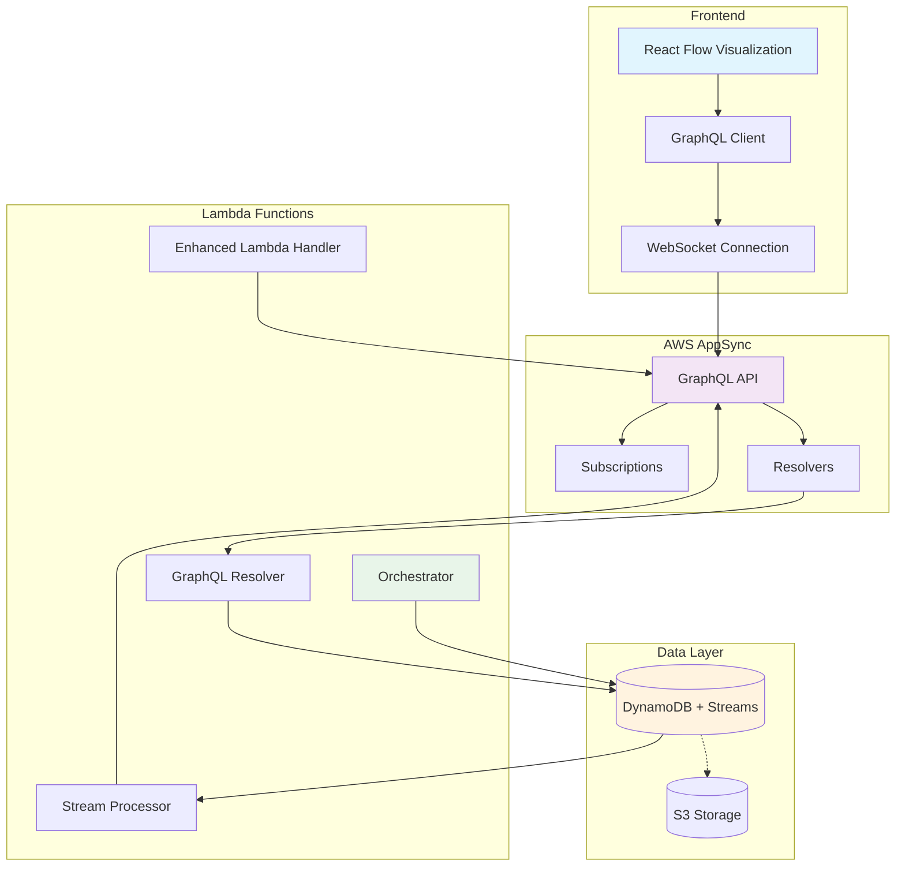

# Real-time Pipeline Visualization System

## Overview

This document describes the complete real-time update system for the Multi-Step LLM Pipeline, featuring GraphQL subscriptions, React Flow visualization, and AWS AppSync integration.

## Architecture

### High-Level Architecture



### Component Breakdown

#### 1. Frontend Components

- **React Flow Visualization**: Interactive pipeline flow diagram
- **GraphQL Hooks**: Real-time subscription management
- **Stage Detail Modals**: Detailed view of individual pipeline stages
- **Execution List**: Historical and active pipeline executions

#### 2. GraphQL Schema

- **ExecutionUpdate**: Complete pipeline execution state
- **StageUpdate**: Individual stage progress and outputs  
- **Real-time Subscriptions**: Live updates via WebSocket
- **Queries & Mutations**: CRUD operations for executions

#### 3. Backend Services

- **Enhanced Lambda Handler**: GraphQL-integrated pipeline execution
- **Stream Processor**: DynamoDB streams to GraphQL subscriptions
- **GraphQL Resolvers**: Complex business logic for queries/mutations

## Key Features

### Real-time Updates

- **Live Progress Tracking**: Visual progress indicators update in real-time
- **Stage Completion Notifications**: Immediate feedback when stages complete
- **Error State Visualization**: Real-time error highlighting and details
- **Output File Tracking**: Live updates of generated artifacts

### Interactive Visualization

- **React Flow Integration**: Drag-and-drop pipeline visualization
- **Stage Click-through**: Detailed modals for individual stages
- **Progress Animations**: Animated progress bars and edge flows
- **Status Color Coding**: Visual status indicators (running, completed, failed)

### Performance Optimizations

- **Subscription Filtering**: Filter updates by specific job ID
- **Connection Resilience**: Automatic reconnection with exponential backoff
- **Debounced Updates**: Smooth UI updates without flickering
- **Efficient State Management**: Minimal re-renders with optimized React hooks

### Security Features

- **IAM-based Authentication**: AWS IAM roles for Lambda-to-AppSync
- **API Key Management**: Secure GraphQL API access
- **CORS Configuration**: Proper cross-origin resource sharing
- **Input Validation**: Comprehensive input sanitization

## Deployment

### Prerequisites

- AWS CLI configured
- SAM CLI installed
- Node.js 18+ installed
- Docker (for SAM build)

### Quick Deployment

```bash
# Clone and navigate to project
cd multi-step-llm-app

# Run deployment script
./deploy-realtime-system.sh
```

### Manual Deployment Steps

1. **Install Dependencies**:
   ```bash
   # Lambda dependencies
   cd graphql/resolvers && npm install && cd ../..
   cd graphql/stream-processor && npm install && cd ../..
   
   # Python dependencies
   pip install -r requirements.txt
   ```

2. **Build SAM Application**:
   ```bash
   sam build --use-container
   ```

3. **Deploy Infrastructure**:
   ```bash
   sam deploy --stack-name multi-step-pipeline \
              --capabilities CAPABILITY_IAM \
              --resolve-s3
   ```

4. **Configure Frontend**:
   ```bash
   # Copy GraphQL API URL and Key from stack outputs
   cd frontend
   cp .env.example .env
   # Edit .env with your API endpoints
   npm install && npm start
   ```

## Configuration

### Environment Variables

#### Frontend (.env)
```bash
REACT_APP_GRAPHQL_URL=https://xxx.appsync-api.us-east-1.amazonaws.com/graphql
REACT_APP_GRAPHQL_API_KEY=da2-xxxxxxxxxxxxxxxxxx
REACT_APP_REST_API_URL=https://xxx.execute-api.us-east-1.amazonaws.com/production
REACT_APP_AWS_REGION=us-east-1
REACT_APP_ENVIRONMENT=production
```

#### Lambda Functions
```bash
JOBS_TABLE=PipelineJobs-production
GRAPHQL_API_URL=https://xxx.appsync-api.us-east-1.amazonaws.com/graphql
GRAPHQL_API_ID=xxxxxxxxxxxxxxxxxx
ORCHESTRATOR_FUNCTION_NAME=pipeline-orchestrator-production
```

### AWS Resources Created

- **AppSync GraphQL API**: Real-time subscriptions
- **DynamoDB Table**: Job tracking with streams
- **Lambda Functions**: 4 total (starter, orchestrator, resolver, stream processor)
- **IAM Roles**: Secure cross-service communication
- **API Gateway**: REST API for compatibility
- **S3 Bucket**: Pipeline artifact storage

## Usage

### Starting the Frontend

```bash
cd frontend
npm start
```

Open http://localhost:3000 to view the pipeline visualization.

### Creating a New Execution

1. Click "New Execution" button
2. Enter Research Document ID
3. Specify username
4. Optional: Add pipeline configuration JSON
5. Click "Start Execution"

### Monitoring Real-time Updates

- **Pipeline View**: Visual flow diagram with live progress
- **Stage Details**: Click stages to view detailed information
- **Connection Status**: Real-time WebSocket connection indicator
- **Execution List**: Historical and active executions

## GraphQL API Reference

### Subscriptions

```graphql
# Subscribe to execution updates
subscription OnExecutionUpdate($jobId: ID!) {
  onExecutionUpdate(jobId: $jobId) {
    jobId
    status
    currentStage
    stageProgress
    overallProgress
    estimatedRemainingMinutes
    completedStages {
      stageId
      name
      status
      progress
      outputs {
        fileName
        contentPreview
        fileSize
      }
    }
    timestamp
  }
}
```

### Queries

```graphql
# Get specific execution
query GetExecution($jobId: ID!) {
  getExecution(jobId: $jobId) {
    jobId
    status
    overallProgress
    metadata {
      researchDocId
      username
      startedAt
    }
  }
}

# List all executions
query ListExecutions($username: String, $limit: Int) {
  listExecutions(username: $username, limit: $limit) {
    items {
      jobId
      status
      overallProgress
      timestamp
    }
    nextToken
  }
}
```

### Mutations

```graphql
# Start new execution
mutation StartExecution($input: StartExecutionInput!) {
  startExecution(input: $input) {
    jobId
    status
    timestamp
  }
}

# Update stage progress (internal use)
mutation UpdateStageProgress($input: UpdateStageProgressInput!) {
  updateStageProgress(input: $input) {
    jobId
    currentStage
    stageProgress
    overallProgress
  }
}
```

## Development

### Local Development Setup

1. **Backend**:
   ```bash
   # Start local DynamoDB
   docker run -p 8000:8000 amazon/dynamodb-local
   
   # Set environment variables
   export JOBS_TABLE=PipelineJobs-local
   export AWS_ENDPOINT_URL=http://localhost:8000
   
   # Run Lambda locally
   sam local start-api
   ```

2. **Frontend**:
   ```bash
   cd frontend
   npm start
   ```

### Testing

```bash
# Unit tests
python -m pytest tests/

# Integration tests
python -m pytest tests/test_integration_e2e.py -v

# Frontend tests
cd frontend && npm test
```

### Debugging

#### CloudWatch Logs
```bash
# GraphQL resolver logs
aws logs tail /aws/lambda/multi-step-pipeline-GraphQLResolverFunction --follow

# Stream processor logs
aws logs tail /aws/lambda/multi-step-pipeline-StreamProcessorFunction --follow

# Orchestrator logs
aws logs tail /aws/lambda/multi-step-pipeline-OrchestratorFunction --follow
```

#### GraphQL Query Testing
Use the AWS AppSync console to test queries and subscriptions:
1. Go to AWS AppSync in the console
2. Select your API
3. Use the "Queries" section for testing

## Performance Considerations

### Scalability

- **DynamoDB**: Auto-scaling enabled for reads/writes
- **Lambda Concurrency**: Reserved concurrency for orchestrator
- **AppSync Limits**: 100 concurrent subscriptions per connection
- **WebSocket Connections**: Automatic reconnection handling

### Cost Optimization

- **DynamoDB TTL**: Automatic cleanup of old job records (30 days)
- **Lambda Memory**: Right-sized memory allocation
- **AppSync Pricing**: Pay-per-request and subscription
- **S3 Lifecycle**: Consider lifecycle policies for artifacts

### Monitoring

- **CloudWatch Metrics**: Lambda duration, DynamoDB throttling
- **X-Ray Tracing**: End-to-end request tracing
- **AppSync Metrics**: Query/mutation/subscription counts
- **Custom Metrics**: Pipeline success/failure rates

## Troubleshooting

### Common Issues

1. **WebSocket Connection Failures**:
   - Check API key configuration
   - Verify CORS settings
   - Check network connectivity

2. **Real-time Updates Not Working**:
   - Verify DynamoDB streams are enabled
   - Check stream processor Lambda logs
   - Confirm subscription is active

3. **GraphQL Resolver Errors**:
   - Check IAM permissions
   - Verify DynamoDB table access
   - Review CloudWatch logs

4. **Frontend Build Issues**:
   - Ensure environment variables are set
   - Check Node.js version compatibility
   - Clear npm cache if needed

### Log Analysis

```bash
# Search for errors across all functions
aws logs filter-log-events \
  --log-group-name "/aws/lambda/multi-step-pipeline" \
  --filter-pattern "ERROR" \
  --start-time $(date -d "1 hour ago" +%s)000
```

## Future Enhancements

### Planned Features

- **Multi-tenant Support**: User-based data isolation
- **Advanced Filtering**: Filter executions by date, status, etc.
- **Export Capabilities**: Export execution data to CSV/PDF
- **Metrics Dashboard**: Execution success rates and performance
- **Mobile Responsive**: Mobile-optimized visualization
- **Dark Mode**: Theme switching support

### Performance Improvements

- **GraphQL Caching**: Implement query result caching
- **Batch Operations**: Batch multiple stage updates
- **Optimistic Updates**: Update UI before server confirmation
- **Pagination**: Implement cursor-based pagination

### Security Enhancements

- **Cognito Integration**: User authentication and authorization
- **Fine-grained Permissions**: Resource-level access control
- **Audit Logging**: Comprehensive activity logging
- **Rate Limiting**: Prevent API abuse

## Support

For issues and questions:
1. Check CloudWatch logs for detailed error information
2. Review this documentation for configuration guidance
3. Test with the provided GraphQL examples
4. Use the deployment script for consistent setup

The real-time pipeline visualization system provides a comprehensive view of your multi-step LLM pipeline execution with professional-grade real-time capabilities and visual feedback.